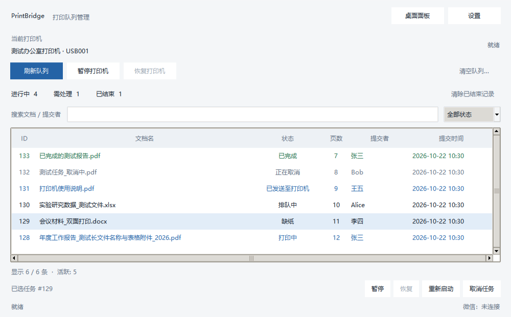

# PrintBridge

Windows 桌面打印队列工作台：看清任务状态，在主窗口、托盘和桌面面板中管理打印。

[](https://github.com/moewu325-hue/printbridge/releases)  [](LICENSE)

PrintBridge 把队列、打印机状态和持久历史集中到一个轻量桌面工具中，适合需要持续查看打印进度、切换设备或排查异常的 Windows 用户。提供无需安装 Python 的单文件 EXE，也保留源码与 JSON 命令行入口；微信联动按需开启。



界面图使用合成数据，展示状态筛选、文档搜索和所选任务操作。

## 主要能力

| 能力 | 使用方式与边界 |
| --- | --- |
| 队列工作台 | 实时查看作业，按状态筛选，搜索文档或提交者，操作所选任务 |
| 打印控制 | 暂停、恢复、取消任务或清空队列；明确指定的设备不可用时不会静默换机 |
| 持久历史 | SQLite 保存任务记录；缺纸、脱机和错误恢复后继续更新同一记录 |
| 桌面面板 | 完整卡片与任务栏条两种模式，查看本机设备和队列，提供右键操作 |
| 托盘常驻 | 隐藏/恢复主窗口，显示/隐藏面板，统一退出程序 |
| 微信与 CLI | 可选微信命令/通知；源码 CLI 提供状态、队列、搜索、打印和取消的 JSON 输出 |

## 快速开始

1. 从 [Releases](https://github.com/moewu325-hue/printbridge/releases) 下载 `PrintBridge-x64.exe`，在 Windows 10/11 x64 双击运行。
2. 在设置中选择打印机；留空时使用 Windows 系统默认设备。先查看队列与状态，再按需执行任务操作。
3. 通过工具栏打开「桌面面板」，或关闭主窗口后从托盘恢复；托盘不可用时关闭窗口会退出程序。

无需安装 Python。明确指定的设备不可用时不会自动换机；新安装默认关闭微信和自动文件打印，升级保留已有显式配置。

## 数据与配置

默认数据目录为 `%LOCALAPPDATA%\PrintBridge`，包含 `config.json`、`print_history.db`、`logs/` 和暂存文件。数据与单文件EXE解压资源分离，重启不会因临时目录清理丢失设置。可用 `PrintBridge-x64.exe --data-dir "D:\PrintBridgeData"` 或环境变量 `PRINTBRIDGE_DATA_DIR` 指定独立数据目录。首次默认启动可从EXE旁的旧配置与历史迁移，已有新目录文件不会覆盖；显式目录不自动迁入旧数据。原JSON损坏时保留原件并报告位置。

## 桌面打印面板

主窗口工具栏「桌面面板」或托盘菜单「显示/隐藏打印面板」可打开常驻小窗，关闭主窗口到托盘后面板仍可使用。面板支持完整卡片与任务栏条两种模式，可在右键菜单切换；任务栏条默认贴靠在 CodexUsageBar 上方，找不到该窗口时回落到工作区右下角。

面板显示默认打印机与状态、当前查看打印机的队列，以及本机全部打印机（虚拟/传真机默认折叠，可展开）。左键点击打印机只切换面板的查看对象，不会修改系统默认；设为默认需右键选择并确认。右键还可暂停/恢复打印、清空队列、取消任务、打开队列或打印机属性窗口。

面板复用主程序的打印控制模块，只读旁观：不写 `print_history.db`，不发送微信通知。隐藏面板后停止轮询；面板配置与主程序共用 `config.json`，字段以 `panel_` 开头。

## 代码组织

`main.py` 负责参数与错误入口，`desktop_app.py` 组合窗口和后台生命周期，`app_runtime.py` 消费后台任务；`gui/theme.py` 集中视觉样式，`gui/job_view_model.py` 独立处理队列身份、状态计数与筛选。`printer/` 管理设备/历史状态，`panel/` 提供只读快照与桌面视图，`wechat/` 隔离可选UIAutomation边界；两类界面共用打印控制。

```text
PrintBridge/
├── main.py / desktop_app.py / app_runtime.py  # 入口与生命周期
├── printbridge_cli.py                         # 命令行
├── gui/                                      # 主窗口、设置与样式
├── printer/                                  # 打印控制与历史
├── panel/                                    # 桌面面板
├── wechat/                                   # 可选微信适配
├── scripts/                                  # 构建、源码发行与许可收集
├── tests/                                    # 回归测试
└── docs/                                     # 界面示例与验证记录
```

## 状态的含义

- `已完成`：打印驱动报告 `JOB_STATUS_PRINTED`；驱动能力会影响此报告，无法证明实际纸张已输出。
- `已发送至打印机`：驱动报告 `JOB_STATUS_COMPLETE`，仍作为活跃作业跟踪。
- `已移除`：作业离开队列但没有明确完成/取消证据，结果未知；不会发成功通知。
- 缺纸、脱机、错误均可恢复；恢复后仍更新同一历史记录。

## 微信联动

新安装默认关闭微信和自动文件打印；升级保留已有配置。需要时在设置中启用，按精确会话名称维护监听白名单与通知目标。仅在微信客户端UI结构、目标标题、消息区和输入框都匹配时工作，匹配失败会拒绝操作。首次看到的聊天消息仅建立基线，不执行历史命令。

支持 `/status`、`/list`、`/pause`、`/resume`、`/cancel <id|all>`、`/print <完整路径>`、`/help`。会话白名单意味着该会话内的消息可执行这些命令，群聊须据此选择。手动 `/print` 受微信开关、白名单与允许扩展名约束；自动打印另受自动开关约束。

当前未实现可靠的“某条文件消息→本地下载文件”绑定，因此不会把任意账号的“最近文件”猜作新收件自动打印；该自动收件能力暂不可用。客户端适配使用UIAutomation，不含微信账号或聊天数据，也没有服务器消息送达确认；本发行以mock验证边界，未对真实微信客户端发送消息验收。

## 命令行

源码CLI需要Python与运行依赖；EXE为桌面入口，不另打包CLI程序。打印/取消是实际操作，查询和搜索只读。

```powershell
python printbridge_cli.py --status --json
python printbridge_cli.py --list --printer "打印机名称" --json
python printbridge_cli.py --search "报告" --json
python printbridge_cli.py --print "D:\Documents\报告.pdf" --printer "打印机名称" --json
python printbridge_cli.py --cancel 123 --printer "打印机名称" --json
```

`--json` 始终输出单个 `{ok, command, data, error}` 对象；操作失败退出非零。显式 `--printer` 优先于配置，否则用系统默认。完整路径/带目录路径指向指定文件；裸文件名只在唯一精确匹配时允许打印，模糊匹配用于搜索，多个候选返回歧义错误。

为避免跨账号和全盘扫描，搜索目录由 `PRINTBRIDGE_WECHAT_FILES`、`PRINTBRIDGE_SEARCH_DIRS` 显式配置；多个目录用Windows分号分隔。未配置时不扫描个人微信存储。只读CLI不创建或重写配置。

## 技术栈与源码运行

Python **3.11 x64**、Tkinter、pywin32、SQLite、pystray、Pillow；可选微信适配使用 UIAutomation/comtypes，EXE 使用 PyInstaller 打包。固定依赖见 `requirements*.txt`，没有新增服务器或网络API。

```powershell
git clone https://github.com/moewu325-hue/printbridge.git
cd printbridge
python -m venv .venv
.venv\Scripts\python -m pip install -r requirements.txt
.venv\Scripts\python main.py
```

## 验证与构建

```powershell
.venv\Scripts\python -m pip install -r requirements-build.txt
.venv\Scripts\python -B -m unittest discover -s tests -v
./scripts/build.ps1 -Python .venv\Scripts\python.exe
```

输出 `dist/PrintBridge.exe`。打包依赖标准hooks与实际使用的模块，未使用外部压缩壳。发布源码ZIP使用 `python scripts/build_release.py dist/PrintBridge-v1.2.0-source.zip`，只收录Git已跟踪文件并生成逐文件校验和；同一Python/zlib工具链与输入可复现源码ZIP，EXE不承诺字节复现。请在正式发布前确认Git跟踪范围。

隔离GUI烟测：`dist\PrintBridge.exe --data-dir "D:\PrintBridgeSmoke" --smoke-test`，会自动退出并写该目录的 `smoke.json`；不会启动微信或提交打印操作。常规GUI测试使用真实Tk窗口对象；打印驱动和微信回归使用mock隔离副作用。Windows CI执行测试、打包及冻结入口烟测。

实际验证与限制见 [docs/validation.md](docs/validation.md)。真实纸张输出、Office/PDF文件关联、微信客户端UI兼容和消息投递未验；`printto` 需要相应文件关联支持，返回成功仅表示已发起请求。

现有验证记录包含本机144项测试、源码与冻结入口烟测，以及通过的 [Windows CI](https://github.com/moewu325-hue/printbridge/actions/runs/39716071499)。Explorer重启、不同厂商驱动、远程打印服务器和多显示器混合缩放尚未穷尽验证。

## 常见问题

**为什么窗口关闭后程序还在？** 托盘可用时关闭窗口会隐藏；从托盘菜单退出可停止程序，托盘不可用则关闭即退出。

**为什么「已完成」后仍要检查打印机？** 该状态来自驱动报告，实际纸张输出仍需设备侧确认。

**为什么找不到微信文件？** CLI只搜索显式配置的目录；自动附件收件暂不可用，可使用有完整路径的手动命令。

**能否把数据放到其他目录？** 使用 `--data-dir` 或 `PRINTBRIDGE_DATA_DIR`；指定目录不会自动混入旧数据。

## 许可与依据

本项目代码采用 [MIT](LICENSE)；EXE中第三方组件沿用各自许可，见 [THIRD_PARTY_NOTICES.md](THIRD_PARTY_NOTICES.md)。

状态解释依据微软 [JOB_INFO_2](https://learn.microsoft.com/en-us/windows/win32/printdocs/job-info-2)；指定目标的文件关联依据 [printto](https://learn.microsoft.com/en-us/windows/win32/shell/context) 和 [ShellExecute](https://learn.microsoft.com/en-us/windows/win32/api/shellapi/nf-shellapi-shellexecutea)。资源与可写路径参考 [PyInstaller运行时说明](https://pyinstaller.org/en/stable/runtime-information.html)，数据库连接显式关闭遵循 [sqlite3文档](https://docs.python.org/3.11/library/sqlite3.html)。
